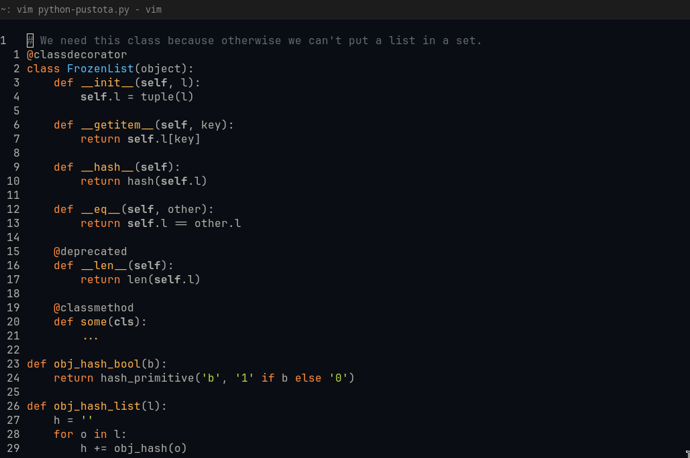
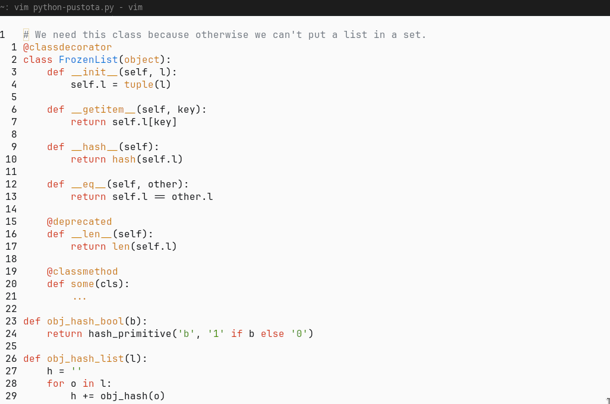

<p align="center">
  
</p>

<p align="center">
  
</p>

1. copy a theme file to  ~/.vim/colors/:
    ```bash
    mkdir -p ~/.vim/colors
    cp colors/pustota_dark.vim ~/.vim/colors/
    ```
2. add to your  ~/.vimrc:
    ```vim
    syntax on
    set termguicolors
    colorscheme pustota_dark " or pustota_light
    ```
3. restart vim
